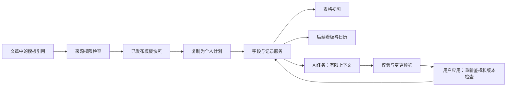

# PaiCoding 多维表格调研与首期设计

调研日期：2026-11-18（Asia/Taipei）。代码基线：`main@e4535f59`，开始调研时工作区干净。

> 本文保留为实施前的调研草案。独立工作区及个人副本方案已撤销，文章原位表格和学习助手已完成代码及本地验收，实际范围、数据结构、固定组件版本及验证结果以 [文章表格与 AI 学习助手](article-tables.md) 为准。下文的建议阶段、估时和拟议设计不代表最终实现；尚未部署上线。

## 1. 建议决策

建设 PaiCoding 自有的轻量多维表格：**复用网格组件，自建字段、记录、视图、权限和学习计划业务**。前端首选验证 Tabulator，后端沿用 Java 8 / Spring Boot / MyBatis-Plus / MySQL；无需先更换整站编辑器或引入独立低代码平台。

首个闭环是：作者把「3个月冲刺计划」发布为表格模板，读者在文章内浏览，复制到「我的学习计划」，按自己的日期安排任务、记录完成情况。AI 从选定文章提取任务并生成草稿，用户查看差异后写入个人计划。

建议首期包含表格视图与按状态分组；看板、日历放在下一阶段，复用相同记录。首期就建立稳定字段 ID 和视图配置，避免以后从 HTML 表格重做数据模型。人员协作、跨表关联、公式引擎、自动化工作流和完整 Excel 兼容暂缓。

**组件推荐是基于文档和代码适配度的判断，不是性能实测结论。** 先做 2–3 人日 PoC，检查中文输入、冻结列、长文本、移动端和样式隔离，合格后锁定版本。

## 2. 当前实现与缺口

以下路径均相对仓库根目录，可按方法名定位；不依赖生产数据库或线上凭据。

| 范围 | 已核实的实现 | 对新能力的影响 |
| --- | --- | --- |
| 编辑器 | `paicoding-ui/src/main/resources/templates/views/article-edit/index.html`，约 465 行调用 Editor.md，工具栏含 `table` | 现有入口可以继续写 Markdown；增加「插入多维表格」入口即可 |
| 内容存储 | `paicoding-service/src/main/java/com/github/paicoding/forum/service/article/repository/entity/ArticleDetailDO.java`，含 `articleId`、`editionId`、`version`、`content`、`metadataSnapshot` | 表格目前属于正文；独立可编辑记录需要新的表，嵌入绑定必须考虑文章版本 |
| Markdown 渲染 | `paicoding-core/src/main/java/com/github/paicoding/forum/core/util/MarkdownConverter.java`，Flexmark `TablesExtension`；HTML 按 Markdown 内容做 Caffeine 缓存 | 可新增受控嵌入节点；纯渲染缓存不能装入用户私有进度或鉴权结果 |
| 展示 | `paicoding-ui/src/main/resources/templates/components/article/article-detail.html` 的 `articleContent` 通过 `th:utext` 输出正文；`static/css/global.css` 约 924 行为普通 HTML table 样式 | 新网格要独立 CSS 命名空间；旧表格渲染保留兼容 |
| 文章权限 | `paicoding-web/src/main/java/com/github/paicoding/forum/web/front/article/extra/ArticleReadViewServiceExtend.java#formatArticleReadType`，处理普通、登录、星球、付费及作者例外 | 不能只给表格接口加登录校验；读取模板还要判断来源内容是否可读 |
| 教程权限 | 同模块 `front/article/view/ColumnViewController.java#updateReadType`、`trimContent`，处理教程类型、章节覆盖、限时免费和预览截断 | 教程与普通文章目前不在同一授权入口；应抽出共享策略供表格调用，保留原语义 |
| 接口权限 | `paicoding-web/src/main/java/com/github/paicoding/forum/web/hook/interceptor/GlobalViewInterceptor.java#preHandle` 读取 `@Permission`；身份来自 `ReqInfoContext` | 能复用身份与角色检查，资源归属、模板发布权限和个人数据隔离仍需新增 |
| AI 路由 | `paicoding-service/src/main/java/com/github/paicoding/forum/service/chatai/ChatFacade.java`、`service/ChatServiceFactory.java` | 已有供应商路由基础，不能据此宣称某模型生产环境已可用 |
| AI 上下文与额度 | 同目录 `service/AbsChatService.java`，加载聊天历史、按用户/来源统计次数，部分记录依赖请求上下文 | 表格批处理需要独立任务、显式身份、独立上下文和 token 成本核算 |
| AI 结构化先例 | `service/article/service/impl/AiSeoServiceImpl.java` 已直接调用 `ZhipuIntegration`、解析 JSON 并设置超时 | 可参考直接调用路径；不能把要求 JSON 的提示词等同于可靠结构校验 |
| DeepSeek 适配 | `service/chatai/service/impl/deepseek/DeepSeekIntegration.java#directReturn` 在搜索服务可用时附加工具，还会记录请求和输出 | 表格任务应提供显式 tools-off 选项与脱敏日志，不能直接复用默认行为发送私有学习数据 |
| 数据迁移 | `paicoding-web/src/main/resources/liquibase/master.xml` 当前 include `changelog/000_initial_schema.xml` | 新建独立变更集并接入 master；保持历史 changeset 不变 |

核查的文章、教程和实体路径中未发现独立多维表格业务。这里判断的是本仓库的文章/学习计划链路，不意味着所有管理后台都没有列表控件。

截图能确认长文本导致行高很大、列宽紧张；没有实际浏览器测量，不能仅凭截图断定唯一 CSS 根因。此次不访问生产账号、不读取密钥配置、不调用收费模型。

## 3. 从飞书借鉴什么

飞书把字段类型与记录数据分开，并让同一份记录切换为表格、看板、日历等视图；视图配置控制筛选、排序、分组等展示行为。PaiCoding 应借鉴这一数据组织方式，而不是仅给 Markdown 表格添加边框和颜色。[飞书快速上手](https://www.feishu.cn/hc/zh-CN/articles/697278684206-%E5%BF%AB%E9%80%9F%E4%B8%8A%E6%89%8B%E5%A4%9A%E7%BB%B4%E8%A1%A8%E6%A0%BC)、[视图说明](https://www.feishu.cn/hc/zh-CN/articles/360049067931-%E4%BD%BF%E7%94%A8%E5%A4%9A%E7%BB%B4%E8%A1%A8%E6%A0%BC%E8%A7%86%E5%9B%BE)

AI 字段捷径通过引用字段执行文本提取、分类、总结等工作。本站可以先提供选中记录后的批量操作，把模型输出转换为字段变更草稿，保留来源、状态、失败原因与应用结果。[飞书 AI 字段捷径](https://www.feishu.cn/hc/zh-CN/articles/464880997049-%E4%BD%BF%E7%94%A8%E5%A4%9A%E7%BB%B4%E8%A1%A8%E6%A0%BC-ai-%E5%AD%97%E6%AE%B5%E6%8D%B7%E5%BE%84)

| 维度 | 文章普通表格 | 本次拟建多维表格 |
| --- | --- | --- |
| 数据单位 | 正文中的单元格文本 | 有稳定 ID 的字段和记录 |
| 编辑 | 修改 Markdown 并保存正文 | 单元格/记录更新、版本冲突检测 |
| 展示 | 一份固定排版 | 同一数据的筛选、分组和多个视图 |
| 读者行为 | 阅读、复制文字 | 复制模板、管理个人计划、打卡 |
| AI 输出 | 一段说明文字 | 可校验、可预览、可应用的结构化变更 |

完整电子表格的 A1 单元格引用、复杂公式、合并单元格与宏不是首个学习计划场景的核心。飞书外链或 iframe 可用于临时分享，但本站用户身份、星球权限、个人副本和数据归属仍需额外整合，不作为主方案。

## 4. 技术选型

以下维护状态仅反映 2026-11-18 本次读取的官方页面。实施时再次核对选定版本、分发文件及依赖许可证，不直接引用浮动 `latest`。

| 方案 | 已核实能力与许可 | 集成判断 | 结论 |
| --- | --- | --- | --- |
| Tabulator | MIT；文档覆盖编辑、分组、冻结列、排序筛选及下载；安装支持直接使用 JS/CSS。官方 6.x 页面展示 6.6.1，并有版本修复记录 | 适合 Thymeleaf 页面局部挂载；需要自建字段配置、记录详情、持久化、权限、看板与日历 | **首选 PoC** |
| AG Grid | Community 免费生产使用；Enterprise 生产需许可。官方将行分组、Excel 导出等列为 Enterprise 能力；支持原生 JS。文档显示 36.3.0 | 通用网格能力强；本期分组诉求需核对商业版边界，避免先按免费方案做完再补费用 | 有商业预算时的备选 |
| VisActor VTable | MIT；VRender/Canvas 路线，提供编辑器、导出、甘特等包。Releases 可见 v1.26.8，条目内容日期为 2026-09-11 | 大规模可视化值得评估；中文输入、链接、可访问性、手机交互需重点验证；不能把官方大数据宣传当本站基准 | 数据规模增长后的候选 |
| Teable 整体平台 | PostgreSQL 驱动的独立多维表格产品；核心 Next.js/NestJS 应用为 AGPL-3.0，packages 为 MIT，LICENSE 另列品牌条款；可见 2026-11-17 发布记录 | 成品覆盖更广，但引入独立运行时、数据库、账号映射和升级运维；发布频繁不等于所有自托管功能免费可用 | 适合独立工作台方向，本期不嵌入整套平台 |
| 完全自研网格 | 无上游网格依赖，功能与质量全部自担 | 编辑焦点、输入法、虚拟滚动、粘贴、键盘和兼容性会消耗大量时间 | 自研业务层，避免从零写网格 |

依据：[Tabulator 安装](https://www.tabulator.info/docs/6.x/install/)、[许可](https://www.tabulator.info/docs/6.x/license/)、[编辑](https://www.tabulator.info/docs/6.x/edit/)、[分组](https://www.tabulator.info/docs/6.x/group/)、[布局与冻结列](https://www.tabulator.info/docs/6.x/layout/)、[发布说明](https://www.tabulator.info/docs/6.x/release/)；[AG Grid 版本能力边界](https://www.ag-grid.com/javascript-data-grid/community-vs-enterprise/)；[VTable 仓库](https://github.com/VisActor/VTable)、[发布记录](https://github.com/VisActor/VTable/releases)；[Teable 仓库](https://github.com/teableio/teable)、[许可证原文](https://github.com/teableio/teable/blob/develop/LICENSE)、[发布记录](https://github.com/teableio/teable/releases)。许可证信息用于选型边界识别，具体集成范围按所选版本条款核对。

Tabulator 的下载功能不等于本站已具备安全导出接口，也不等于 XLSX 无额外依赖。首期只支持 CSV；Excel 工作簿导入导出以后单独评估解析器、文件限额与样式保真。[Tabulator 下载文档](https://www.tabulator.info/docs/6.x/download/)

## 5. 首个场景与交互

### 5.1 从宽表变为可执行计划

原表按 Day 横向放置多个学习方向，适合概览但不利于逐项跟踪。保留原概览作为阅读材料，首次转换时展示映射预览，推荐一个学习任务一条记录：

| 字段 | 类型 | 示例/规则 |
| --- | --- | --- |
| 任务 | 短文本 | Java 基础篇 1–6 |
| 学习方向 | 单选 | 面渣逆袭 / 算法 / MYDB / PaiCLI / PaiAgent |
| 阶段 | 单选 | 第一个月 |
| 起始天 / 结束天 | 数字 | 1 / 1；Day 4～7 保留 4 / 7，不强行复制为四份 |
| 开始日期 / 截止日期 | 日期 | 由副本的起始日和天数偏移推导；采用用户时区的本地日期 |
| 状态 | 单选 | 未开始 / 进行中 / 已完成 / 暂缓 |
| 预计分钟 | 数字，可空 | 原文没有任务级分配时为空，不凭空拆分总时长 |
| 实际分钟 | 数字，可空 | 用户填写，不能由 AI 自动宣称已完成 |
| 材料 | URL / 站内文章引用 | 保存 articleId 与 editionId；缺少链接时不编造 |
| 备注 | 长文本 | 网格显示两行，详情面板展示全文 |

原表「每天时长 3 小时」是日预算，不能给同一天每项任务都填 3 小时。副本的 `settings_json.dailyCapacityMinutes` 按计划日保存预算；任务预计时间另存，未知值为空。原表「无」不生成任务；空白表示缺失，不自动解释为已完成。迁移保存原行号、原文和转换说明，歧义项标记待确认。

进度默认按任务数计算：已完成 / 未删除且未暂缓的任务数，同时单列暂缓数；分母为 0 显示「暂无任务」。不把该比例标成时长完成率。

### 5.2 页面入口

- 文章/教程内：表格标题、视图工具栏、只读模板、记录详情、主按钮「复制到我的计划」，次按钮「展开表格」。控件位于表格附近，选中的筛选和分组有明确状态。
- 独立页：`/tables/{baseId}`；个人中心增加「我的学习计划」。复制完成后进入独立页，不把个人操作写回作者模板。
- 作者编辑器：新增「插入多维表格」，可新建或选自己有发布权限的模板；弹层编辑字段和记录，发布时固定模板修订号。
- 桌面：固定标题列、可拖列宽、表头固定、两行摘要、记录详情侧栏；表格展开时释放阅读区宽度，保留可见退出入口。
- 手机：优先按天显示任务卡片、状态按钮和详情页；按需进入横向表格，避免直接压缩七八列。首期 Web 适配，小程序显示受权限控制的摘要与可用入口，不承诺复用 DOM 网格。

### 5.3 分期范围

| 能力 | 首期 MVP | 后续 |
| --- | --- | --- |
| 字段 | 短/长文本、数字、日期、单选、多选、复选框、URL；内置文章引用 | 附件、人员、跨表关联、公式、查找引用 |
| 编辑 | 增删记录、行内编辑、字段新增/改名/排序/隐藏、保存状态、版本冲突提示 | 字段类型转换向导、批量填充、复杂撤销 |
| 视图 | 表格、筛选、排序、单字段分组、保存私人视图、冻结列 | 看板、日历、共享视图、仪表盘 |
| 计划 | 模板发布、复制快照、起始日、打卡、基本进度 | 模板升级差异合并、周期任务、团队协作 |
| 导入导出 | UTF-8 CSV 预览导入/导出；作者选定 Markdown 表格转换 | XLSX、飞书单向导入/同步 |
| AI | 选定文章提取任务并预览，作为首期末可单独关闭的试点 | 自然语言建计划、批量补全、周总结、重排计划 |
| 数据保障 | 所有者隔离、来源权限、行版本、操作日志、软删除 | 分享角色、行列级权限、多人实时协同 |

首期字段含数据后禁用类型直接转换，防止日期转数字等造成无提示丢失。允许隐藏字段；删除字段先软删除并保留数据恢复窗口。

## 6. 数据结构与服务边界

### 6.1 建议表结构

初始采用逻辑表元数据 + 每条记录一份结构化值；不按用户建 MySQL 物理表。下列均为新设计，尚未建表。

| 表 | 关键列与约束 |
| --- | --- |
| `mt_base` | id、owner_id、name、kind（template/personal）、source_base_id、source_revision、settings_json、version、deleted |
| `mt_table` | id、base_id、name、schema_version、version、deleted；首期一个 base 一个逻辑表，结构允许以后扩展 |
| `mt_field` | id、table_id、name、type、options_json、sort_order、deleted；稳定 ID 用作值键；单选选项也有稳定 ID |
| `mt_record` | id、table_id、values_json、sort_key、version、created_by、updated_by、deleted；索引 `(table_id, deleted, sort_key, id)` |
| `mt_view` | id、table_id、owner_id、name、type、config_json、version；首期仅模板发布视图和个人私有视图 |
| `mt_revision` | id、base_id、revision_no、snapshot_json、created_by；唯一 `(base_id, revision_no)`，发布后不可变，包含字段/选项/记录/默认视图 |
| `mt_embed` | id、article_id、edition_id、article_detail_id、block_key、base_id、revision_no、column_id（可空）、source_policy；绑定必须指向具体正文修订，不能只用不唯一的 articleId |
| `mt_operation` | id、base_id、actor_id、operation_type、idempotency_key、request_hash、before_json、after_json、created_at；幂等键在操作者及操作域内唯一，重用不同请求拒绝 |
| `mt_ai_job` | id、base_id、actor_id、action、status、input_hash、schema_version、expected_versions、proposal_json、provider、model、usage_json、error_code、lease_until、attempt、created_at |

`values_json` 示例：`{"fld_title":"Java 基础篇 1–6","fld_status":"opt_todo","fld_minutes":null}`。缺失/null 表示未填写，0 表示明确为零；服务端负责类型、范围、长度及字段归属校验。

数据库实际小版本尚未核实。为兼容现状，可先以 LONGTEXT 储存经服务端严格校验的 JSON；不把 JSON 索引能力写成已具备条件。MyBatis-Plus DO 按仓库现有惯例放 `paicoding-service/.../repository/entity`，DTO/请求定义放 `paicoding-api`。虽然项目说明泛称实体在 API，实际文章 DO 在 service，实施沿用邻近模式。

### 6.2 查询、事务与规模边界

建议首期上限：单表 1,000 条、30 字段、单元格长文本 4,000 字符、每次变更最多 100 条、CSV 最大 2 MB、单表序列化值总量 5 MB。限额均为可调设计值，需要 PoC 实测确认；达到上限明确拒绝，不静默截断。

在这个边界内，服务端先按权限读取有界记录，再应用字段白名单筛选/排序/分组，然后分页，保证筛选覆盖整张表，不仅当前页。返回全表匹配总数和分组统计。参数为受控 AST，不接收 SQL、JS 表达式或任意字段路径。若实测成本过高，优先降低 MVP 限额；达到扩容阶段再为常用日期、状态字段建立类型化索引投影。

每次写入事务先锁定逻辑表元数据行，检查 schema_version，再按记录 version 做条件更新；保证字段变更与记录写入不会穿插。单元格更新只提交字段 patch，不覆盖整行旧快照。冲突返回业务码 `TABLE_VERSION_CONFLICT`（建议 HTTP 409），携带当前版本供用户合并。

复制从不可变 revision 开始，事务内生成新字段/选项/记录 ID 并重映射视图引用；个人副本和模板各自独立。重复提交相同幂等键返回同一副本。批量导入先暂存预览、再确认事务提交；任一校验失败整体不写入。暂存数据有所有者、过期时间和内容哈希，应用时重新鉴权。

### 6.3 权限和嵌入

模板发布者默认为原作者或获授权管理员，个人副本仅本人读写。游客只能读取明确公开的已发布模板。客户端传入的 ownerId 不参与身份判定。

抽出 `TableAccessService`，统一 `canReadTemplate`、`canCopyTemplate`、`canEditBase`、`canExport`、`canUseAi`；来源内容判定应复用/抽取文章与教程两套规则，并带入 edition、column 与发布状态。对直接 API、导出、复制、异步任务输入及预览都执行校验，不能依赖页面遮罩。

来源绑定确定授权上下文。把受限模板再次嵌入公开文章，不会自动改变它的可见性；客户端也不能通过删除 columnId 或伪造 editionId 绕过原绑定。不同用户的私有结果不写入共享 HTML 缓存；数据响应默认 private/no-store，内部缓存如需要必须含身份/授权范围和数据版本。

建议 Markdown 使用独占行短语法 `@[paicoding-table](embedId)`，只接受本站合法 ID；由解析器识别节点，不使用全文正则替换代码块中的示例。编辑器预览与服务端渲染使用同一契约。MarkdownConverter 只生成稳定占位，随后由有身份的渲染/接口流程授权并填充。客户端网格按需挂载；SSR/无 JS/导出端提供已授权静态摘要。未授权仅返回锁定提示，不在隐藏 DOM、JSON 或页面源代码中携带记录。

**受限内容复制规则需要产品定稿。** 建议把可复制的计划摘要与受限原文分开，个人打卡永久归用户，点击原文始终重新鉴权；作者显式开放摘要复制。规则未定之前，默认只向公开或明确允许复制的模板开放复制/导出，星球原文不自动搬入个人库。此项不阻碍基础表格研发，但影响星球模板放量。

## 7. API 草案

以下路径为建议，响应沿用项目 `ResVo` 风格；全部嵌套资源都校验其真实父级归属。

| 方法与路径 | 用途与关键检查 |
| --- | --- |
| `POST /api/table/bases` | 新建个人表或作者模板；当前用户决定 owner |
| `GET /api/table/bases?scope=mine` | 本人计划列表；禁止传用户 ID 枚举他人数据 |
| `GET /api/table/embeds/{embedId}` | 校验绑定来源权限后返回发布版本、字段、视图和能力标志 |
| `GET /api/table/bases/{baseId}` | 工作台元数据、版本、可执行操作 |
| `POST /api/table/tables/{tableId}/records/query` | 受控 filter/sort/group、分页；含全表统计 |
| `POST /api/table/tables/{tableId}/records` | 新增记录，schemaVersion、幂等键 |
| `PATCH /api/table/tables/{tableId}/records/{recordId}` | `{expectedVersion,schemaVersion,changes}`；逐字段校验 |
| `POST /api/table/tables/{tableId}/records/batch` | 至多 100 条新增/修改/软删除，原子提交 |
| `POST/PATCH /api/table/tables/{tableId}/fields[/{fieldId}]` | 字段元数据修改、schemaVersion 检查；禁止有值字段直接转换类型 |
| `POST/PATCH /api/table/tables/{tableId}/views[/{viewId}]` | 保存个人视图；只允许有效字段、受支持配置 |
| `POST /api/table/bases/{baseId}/publish` | 发布不可变模板 revision；检查作者及来源绑定 |
| `POST /api/table/embeds/{embedId}/copies` | 来源授权、copyPolicy、revision、起始日期、幂等键 |
| `POST /api/table/tables/{tableId}/imports/preview` | CSV 或选定 Markdown 表格解析、字段映射、错误行报告 |
| `POST /api/table/tables/{tableId}/imports/{importId}/apply` | 重新校验预览哈希/版本/权限后一次写入 |
| `GET /api/table/tables/{tableId}/export?format=csv` | 服务端导出授权数据，处理电子表格公式注入字符 |
| `POST /api/table/bases/{baseId}/ai-jobs` | action、选定记录/字段/文章来源、基准版本；服务端构造最小上下文 |
| `GET /api/table/ai-jobs/{jobId}` | 仅任务所有者查看状态、候选变更、失败原因 |
| `POST /api/table/ai-jobs/{jobId}/apply` | 用户选择变更、权限和版本复核、幂等应用 |
| `POST /api/table/ai-jobs/{jobId}/cancel` | 停止排队或请求取消执行，不把取消结果写入记录 |

URL 仅允许明确协议，文本默认转义；禁止把单元格内容直接注入 `innerHTML`。CSV 按真正 CSV 解析处理引号、逗号、多行及 BOM；导出前处理 `= + - @` 等公式起始字符，不执行公式。Cookie 写接口需验证本站请求来源及 CSRF 防护与现有登录方式的适配，不能默认新增接口天然具备防护。

## 8. AI 如何落地

模型负责产生候选数据；任务服务负责读取授权上下文、调用模型、校验、记录状态和应用结果。首期不需要无限循环 Agent 或自动运行代码。

### 8.1 优先级

| 能力 | 输入 | 交付 | 优先级 |
| --- | --- | --- | --- |
| 文章提取任务 | 当前有权读取的选定文章片段、目标字段 | 附 source article/edition/段落信息的记录草稿 | 首个试点 |
| 自然语言生成计划 | 用户目标、起始日、每日预算、选定模板 | 任务、日期、预计时长及假设说明 | 第二步 |
| 批量补全 | 选中记录及指定输入字段 | 单选分类、摘要、预计分钟等候选值 | 第二步 |
| 进度总结 | 服务端算好的计数、时长、逾期列表 | 有记录依据的总结 | 第二步，数字由程序计算 |
| 按进度重排 | 未完成任务、容量、锁定日期 | 日期调整差异，完成任务保持不动 | 后续 |

生成计划时先检查日容量。无法满足预算就说明冲突，不擅自增大学习时长。AI 不写完成状态、不修改权限、不删除材料，也不把文章中的命令当作工具指令执行。首期不联网搜索，不向模型发送无关聊天记录或整个知识库。

### 8.2 调用与状态

新增 `TableAiService`、`TableAiProvider`，复用现有 Integration 的认证与 HTTP 能力；补齐显式模型选择、tools-off、usage 返回、结构校验、脱敏日志。表格任务独立于 `AbsChatService` 聊天历史。异步工作线程显式传 actorId/baseId，不能假定 HTTP ThreadLocal 始终存在。

状态：`QUEUED → RUNNING → READY_FOR_REVIEW → APPLIED`；异常为 `FAILED / CANCELLED / EXPIRED`。模型输出只保存 proposal，不直接更新记录。输入快照带 schemaVersion、recordVersions、promptVersion；应用时再校验，发生编辑冲突就标记过期并重新生成/让用户取舍，不覆盖新内容。

任务先写数据库，由有租约的 worker 领取；进程重启后回收过期租约，避免只使用内存异步导致任务丢失。最初可单 worker + 有界线程池；无需为了试点强制引入新消息中间件。网络/429 等瞬时错误最多重试一次并退避；无效结构最多修复一次，总调用上限三次，超时或额度不足返回可重试失败。取消后即使模型晚返回也不应用。

首期建议每批最多 20 条、每次最多约 8k 输入 token / 4k 输出 token；这些是产品限额候选，须在具体模型 tokenizer 和上下文上限下校准。模型必须从已配置且可用的来源中显式选择，不把 demo fallback 当成功结果。供应商真实可用性及价格需在实施验收时检查，此次未执行探测或收费调用。

### 8.3 成本与质量

成本按模型实际输入/输出 usage 核算：`输入 token / 1,000,000 × 输入单价 + 输出 token / 1,000,000 × 输出单价`，另计缓存、工具或其他供应商收费项（如有）。例如 5k 输入、2k 输出的任务，成本为 `0.005 × 输入百万单价 + 0.002 × 输出百万单价`；这里不填未经账号核实的人民币单价。

按用户/日、单任务、全站/月设置预算；任务开始先预留，结束按实际结算，失败调用也可能收费。重复任务可按所有者、模型、promptVersion、schemaVersion 和输入哈希复用候选结果，不能跨用户泄露缓存。已有聊天“次数”额度不能直接代表这一成本模型。

建立 20–30 个学习计划样本，覆盖 Day 4～7、缺失时长、预算冲突、无链接、恶意指令等。结构不合规一律不进入可应用状态；评估任务提取准确率、来源覆盖、用户采纳率、人工修改率、P95 延迟和每次成功应用成本。模型更换后重跑这些样本。

## 9. 实施顺序与验收

工期是单名熟悉仓库的全栈开发者、需求稳定情况下的粗估，不是已确认排期。首期含 AI 提取试点约 **24–35 人日**；基础表格可先交付，AI 用开关单独灰度。

| 阶段 | 估算 | 产物与退出条件 |
| --- | --- | --- |
| A：组件 PoC | 2–3 人日 | Tabulator 在真实阅读容器中通过中文输入/冻结/长文本/手机交互；确定固定版本和样式隔离 |
| B：数据与授权 | 5–7 人日 | Liquibase、字段/记录/视图、版本控制、来源权限、两用户隔离测试 |
| C：端到端学习计划 | 7–10 人日 | 作者发布 → 文章嵌入 → 复制 → 打卡；CSV 与个人中心入口、SSR 降级 |
| D：AI 提取试点 | 4–6 人日 | 任务状态、额度、授权上下文、候选预览、幂等应用和失败恢复 |
| E：回归与灰度 | 6–9 人日 | 性能、浏览器/手机、权限、备份恢复、观测指标；公开样例及小范围授权模板试用 |

基础能力稳定后，再安排看板/日历；它们调用相同记录更新接口，例如拖动看板卡片只改状态，日历拖动只改日期，不维护第二份数据。

### 必须通过的验收场景

1. 使用截图同类长文本，网格行高可控、全文可打开；宽度 1440/1024/390 px 均有可操作路径，页面整体不被宽表撑坏；键盘和中文输入法无丢字、重复保存。
2. 同一模板复制给 A、B，A 修改状态后 B 与原模板不变；重复复制请求不重复建表；刷新后视图和进度仍在。
3. 日期/数字/选项等非法输入被服务端拒绝；未知字段 ID、跨表 recordId、伪造 ownerId 均不能越权；字段修改与记录写入竞态不造成类型错乱。
4. 两标签页编辑同一记录，旧版本明确冲突；批量写入任一失败全部回滚；断网时显示未保存，不误报成功。
5. 普通文章、教程、章节特殊规则、星球、限时免费、下线、文章版本切换全部覆盖；直接请求模板/复制/CSV/AI 接口不能绕过源权限。任务开始后撤销权限，应用时拒绝。
6. CSV 的中文、引号、换行、空值和 0 可往返；超限、坏行有明确报告；导出后不触发单元格公式；权限不足的数据不进入导出文件。
7. AI 不输出凭空材料链接，不把日预算重复分到每项任务；拒绝无效 JSON/无效字段，429、超时、进程重启、取消、重复 apply 都能恢复到可解释状态。
8. 90 天正常样本 + 1,000 行/30 字段压力样本：在记录设备/浏览器/网络的前提下，建议首次可交互 P95 ≤ 2 秒、常用筛选 ≤ 300 ms；服务端写入 P95 ≤ 500 ms（不含模型）。这些是待测目标，不是当前成绩。失败时记录瓶颈并调整限额或方案。
9. 关闭功能开关后旧文章仍可阅读；新嵌入显示已授权静态摘要或合理提示；不删除新表数据作为回滚手段。

模块落点建议：`paicoding-api/.../vo/table`、`paicoding-service/.../service/table`、`paicoding-web/.../front/table`、`paicoding-ui/.../templates/views/table` 及独立 `static/js/biz/table` / `static/css/components/table`。具体包层级在实施时按同模块惯例细化。

Java 代码实现后用 Java 8 做针对性测试与模块编译，遵循 AGENTS.md 指定 Maven libexec 入口，不运行 `mvn clean`。本次仅写设计文档，不需要编译整个服务。

## 10. 上线前仍需核实

- 组件 PoC、具体锁定版本与许可证清单、中文输入/屏幕阅读器/移动端表现；此次官方文档阅读不能代替实测。
- 生产 MySQL 小版本、数据量、部署资源和实际性能；未访问生产数据库。
- 表格模板允许发布的人群、星球计划摘要复制/导出的规则；按第 6.3 节默认保守开放范围即可开始研发。
- 实际启用的 AI 供应商、模型、usage 能力和账号单价；新增任务适配器后再做小批真实样本评估。
- 多版本文章绑定与教程路由的完整回归，避免一个内容从另一入口访问时权限语义变化。

本次交付仅此方案文档，未改业务代码、数据库或线上配置，未提交或部署。资料通过公开网页检索读取，未启动临时自动化浏览器，无待关闭浏览器会话。后续 PoC 如启动浏览器，须按项目规则记录归属并在 finally 中关闭和核实退出。
